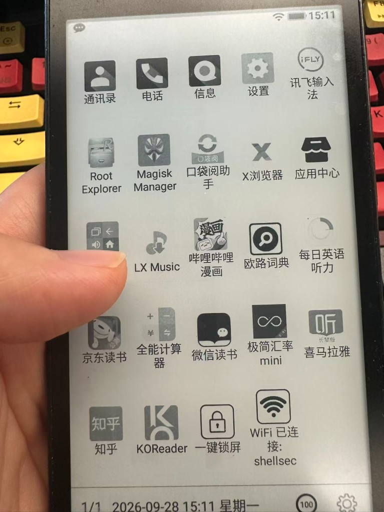

# 洛雪增强版

基于 [lyswhut/lx-music](https://github.com/lyswhut/lx-music) 及其移动版二次开发。

## 下载安装

根据设备架构选择 APK。加速下载使用第三方服务，失效时请使用 GitHub 官方下载；发布页提供 SHA256SUMS.txt 供校验。

| 架构 | 官方下载 | 加速下载 |
| --- | --- | --- |
| arm64-v8a · 64 位设备 | [GitHub](https://github.com/shellsec/lx-music-eink/releases/download/v1.9.3-eink.1/lx-music-mobile-v1.9.3-eink.1-arm64-v8a.apk) | [加速下载](https://ghfast.top/https://github.com/shellsec/lx-music-eink/releases/download/v1.9.3-eink.1/lx-music-mobile-v1.9.3-eink.1-arm64-v8a.apk) · [生成二维码](https://quickchart.io/qr?size=400&margin=4&text=https%3A%2F%2Fghfast.top%2Fhttps%3A%2F%2Fgithub.com%2Fshellsec%2Flx-music-eink%2Freleases%2Fdownload%2Fv1.9.3-eink.1%2Flx-music-mobile-v1.9.3-eink.1-arm64-v8a.apk) |
| armeabi-v7a · 32 位 / 较旧墨水屏设备 | [GitHub](https://github.com/shellsec/lx-music-eink/releases/download/v1.9.3-eink.1/lx-music-mobile-v1.9.3-eink.1-armeabi-v7a.apk) | [加速下载](https://ghfast.top/https://github.com/shellsec/lx-music-eink/releases/download/v1.9.3-eink.1/lx-music-mobile-v1.9.3-eink.1-armeabi-v7a.apk) · [生成二维码](https://quickchart.io/qr?size=400&margin=4&text=https%3A%2F%2Fghfast.top%2Fhttps%3A%2F%2Fgithub.com%2Fshellsec%2Flx-music-eink%2Freleases%2Fdownload%2Fv1.9.3-eink.1%2Flx-music-mobile-v1.9.3-eink.1-armeabi-v7a.apk) |
| universal · 通用版（体积较大） | [GitHub](https://github.com/shellsec/lx-music-eink/releases/download/v1.9.3-eink.1/lx-music-mobile-v1.9.3-eink.1-universal.apk) | [加速下载](https://ghfast.top/https://github.com/shellsec/lx-music-eink/releases/download/v1.9.3-eink.1/lx-music-mobile-v1.9.3-eink.1-universal.apk) · [生成二维码](https://quickchart.io/qr?size=400&margin=4&text=https%3A%2F%2Fghfast.top%2Fhttps%3A%2F%2Fgithub.com%2Fshellsec%2Flx-music-eink%2Freleases%2Fdownload%2Fv1.9.3-eink.1%2Flx-music-mobile-v1.9.3-eink.1-universal.apk) |

[查看全部发布版本](https://github.com/shellsec/lx-music-eink/releases)

## 墨水屏设备展示

沿用原设备照片，仅展示墨水屏上的应用入口，并非新版首次启动界面；使用前仍需自行导入自定义源。

## 导入自定义源

本软件不提供任何音源。首次安装后自定义源列表为空，请在设置中导入自定义源，可选择本地脚本文件或自行填写脚本地址。导入后在设置中选择源。

## 多源自动切换

默认关闭。在设置中选择「多源自动切换」后，播放地址解析失败时，仅在用户导入的源之间按列表顺序重试，每个候选源最多尝试一次。选择具体源即可关闭多源自动切换。在自定义源管理中点击上移、下移按钮设置重试顺序，顺序会保存到本地。

## 手机扫码网页配置

在「设置 → 自定义源管理 → 导入 → HTTP 网页配置」中点击「开启 HTTP 网页」。让墨水屏设备与另一部手机连接同一 Wi-Fi，手机使用系统相机或扫一扫打开设备上显示的二维码，即可在浏览器里填写音源链接、上传脚本或保存订阅地址。也可以手动输入显示的 HTTP 地址，设备本身无需摄像头。

网页配置默认关闭，不会随启动自动开启。二维码在本地生成，只在本次开启期间有效；关闭窗口、关闭 HTTP 网页或应用退到后台后，服务即停止。网页配置同样不会提供或推荐任何音源。

## 订阅更新

在设置中填写自己的 HTTPS 源清单订阅地址，例如 `https://example.com/sources.json`，保存后重启仍有效。默认地址为空，启动时不会检查订阅。点击「从源清单地址更新」可首次导入或手动更新。

清单兼容 `{ "sources": [{ "id": "test", "name": "测试源", "url": "用户自行填写的 HTTPS 脚本地址" }] }`，也支持直接使用条目数组。

启用「多源自动切换」后，已导入的源全部失败时自动检查清单和脚本内容；仅在发生变化时按用户设置的顺序再完整重试一轮，不会递归请求订阅。清单或脚本无变化、订阅请求失败时直接停止，保留本地脚本。

同一首歌、同一地址在本次运行内最多自动检查一次；不同歌曲共用 5 分钟冷却，并发检查合并。手动更新不受冷却限制。已有源的本地顺序保留，新增源追加到末尾；清单移除条目只会移除本订阅管理的源，保留其他手动导入的源。清空地址并保存可关闭订阅。

## 免责声明

本软件不提供任何音源，用户导入的内容由用户自行负责，请遵守当地法律与版权。

## 许可

沿用上游 Apache-2.0 许可证，保留原作者版权声明。修改说明见 [NOTICE](NOTICE)。
